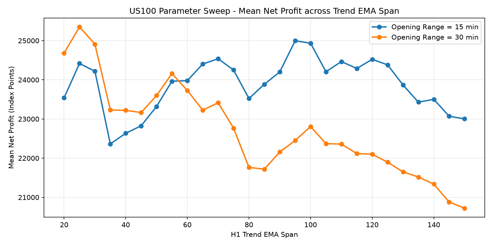
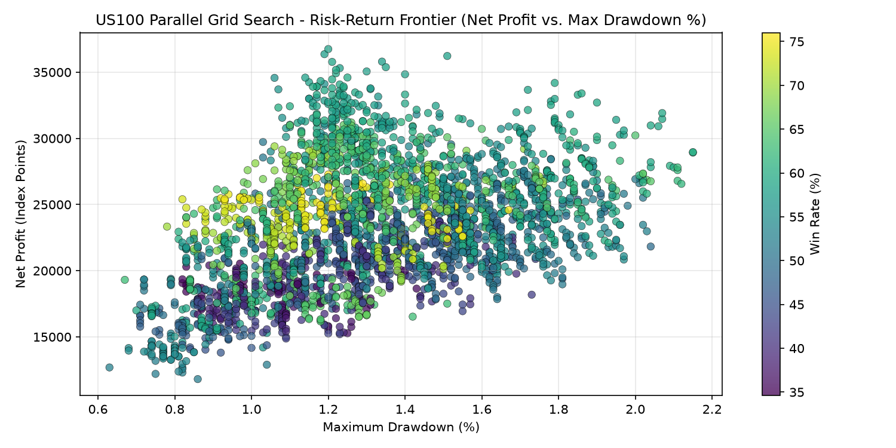

# Nasdaq-100 Parallel Strategy Optimizer & Cross-Index Microstructure

Multiprocess hyperparameter optimization (`joblib.Parallel`), overnight gap econometrics, and cross-index divergence backtesting on high-resolution (`M1` / `M5` / `H1`) Nasdaq-100 (`USTECH100`) and S&P 500 (`US500`) index series.

---

## Overview

This repository provides a three-module quantitative framework designed to evaluate intraday breakout regimes, overnight gap distributions, and multi-index microstructural synchronization:

1. **Multiprocess Opening Range Parameter Optimizer (`src/opening_range_parallel_optimizer.py`)**: Executes parallelized grid searches across Trend EMA spans, Average True Range (`ATR-14`) stop-loss/take-profit multipliers, and New York cash session Opening Range durations (`15 min` vs. `30 min`), incorporating DST-aware timezone alignment (`America/New_York`) and fixed transaction friction (`2.0 pts` spread/slippage penalty per trade).
2. **Overnight Gap Statistical Regime Classifier (`src/overnight_gap_distribution.py`)**: Models 5-year daily overnight gap distributions ($G_t = \frac{\text{Open}_t - \text{Close}_{t-1}}{\text{Close}_{t-1}} \times 100\%$), partitioning sessions into noise ($|G_t| < 0.20\%$), operable ($0.20\% \le |G_t| \le 0.80\%$), and extreme tail regimes ($|G_t| > 0.80\%$) via Kernel Density Estimation (KDE) and Empirical Cumulative Distribution Functions (ECDF).
3. **Cross-Index Synchronization & Microstructure Backtester (`src/cross_index_smt_divergence.py`)**: Aligns 1-minute (`M1`) bars between `USTECH100` and `US500` to evaluate liquidity sweeps, Market Structure Shifts (`MSS`), and 3-candle Fair Value Gaps (`FVG`) during the New York opening window (`14:15 - 16:00 UTC`).

---

## Empirical Optimization Results

Across the full parameter sweep (`results/optimizacion_us100_resultados.csv`, evaluating $>1,500$ executed trades per configuration under a 2.0-point friction penalty), the top-performing parameter plateaus occur at `OR_Min = 30` with `EMA = 20..35` and `SL_X = 1.0 ATR`:

| H1 EMA Span | SL Multiplier (`ATR`) | TP Multiplier (`ATR`) | Opening Range (`min`) | Net Profit (`pts`) | Max Drawdown (`%`) | Executed Trades | Win Rate (`%`) | Recovery Factor |
| :---: | :---: | :---: | :---: | :---: | :---: | :---: | :---: | :---: |
| `20` | `1.0` | `2.0` | `30` | `+17,551.94` | `0.85%` | `1,591` | `47.39%` | `20,662.92` |
| `20` | `1.0` | `1.5` | `30` | `+15,256.98` | `0.79%` | `1,666` | `53.42%` | `19,274.80` |
| `20` | `1.0` | `2.0` | `15` | `+14,721.01` | `0.89%` | `1,568` | `45.79%` | `16,588.85` |
| `20` | `1.0` | `2.5` | `15` | `+16,279.50` | `1.13%` | `1,527` | `41.45%` | `14,469.56` |
| `20` | `1.0` | `1.5` | `15` | `+12,895.87` | `1.04%` | `1,641` | `51.86%` | `12,361.83` |

---

## Visual Analytics

| Mean Net Profit by H1 Trend EMA Span | Risk-Return Frontier (Net Profit vs. Max Drawdown %) |
| :---: | :---: |
|  |  |

---

## Repository Structure

```text
nasdaq-parallel-strategy-optimizer/
├── data/
│   ├── USTECH100M_M1.csv                      # Sample M1 OHLCV series for Nasdaq-100
│   └── US500_M1.csv                           # Sample M1 OHLCV series for S&P 500
├── plots/
│   ├── ema_net_profit_profile.png             # Parameter sensitivity across EMA spans
│   └── risk_return_frontier.png               # Multi-parameter Pareto frontier
├── results/
│   └── optimizacion_us100_resultados.csv      # Complete grid-search empirical results table
├── src/
│   ├── opening_range_parallel_optimizer.py    # Multiprocess grid-search engine (joblib)
│   ├── overnight_gap_distribution.py          # 5-year QQQ overnight gap KDE and ECDF model
│   └── cross_index_smt_divergence.py          # Synchronized NQ vs. ES M1 backtesting engine
├── .gitignore
├── requirements.txt
└── README.md
```

---

## Usage & Reproduction

```bash
# 1. Install dependencies
pip install -r requirements.txt

# 2. Inspect top parameter configurations from the parallel grid search
python src/opening_range_parallel_optimizer.py

# 3. Run cross-index M1 synchronization backtest
python src/cross_index_smt_divergence.py

# 4. Run 5-year Nasdaq overnight gap statistical analysis
python src/overnight_gap_distribution.py
```

---

## Author

**Andrés Felipe Maestre Badillo**  
B.S. Candidate in Energy and Sustainability Engineering — Minor in Data Science  
Universidad Autónoma de Bucaramanga (UNAB)  
Email: afmae556@gmail.com
